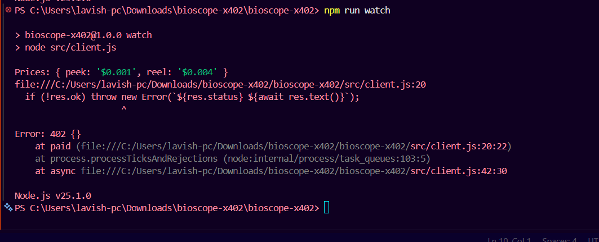
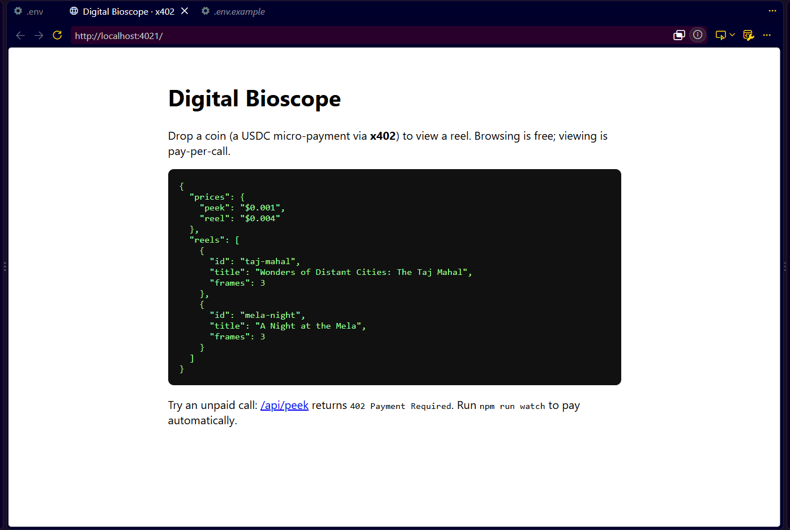

# Digital Bioscope: pay-per-call with x402

Travelling melas had the Bioscope: drop a coin, peer through the eyepiece, watch a reel. This project rebuilds that on the web with **HTTP 402 Payment Required** and the **x402** protocol. Every "peek" is a paid API call settled in USDC on Base Sepolia (testnet).

## Why x402 fits a Bioscope

A Bioscope sells tiny, instant, no-account experiences: one coin, one look. x402 makes the same thing possible for APIs. There are no sign-ups, API keys or subscriptions, and a single frame costs $0.001, which card payments cannot handle economically. The pricing also mirrors the original: peek frame by frame, or pay a bit more for the whole reel in one call.

## Live demo (Base Sepolia)




Three frames purchased with `npm run watch`, three on-chain settlements:

- https://sepolia.basescan.org/tx/0xde9cc89a3486e3d8a9eaf1826ac1744f1b3c8f96aa846a503bb50c0dc335d0a4
- https://sepolia.basescan.org/tx/0x2be21a87edb12cb0bba42c0acfb07720b126a03dd20360afe1b8de88b29c4a89
- https://sepolia.basescan.org/tx/0xc66488bd2ecdc84253925e3f92bcee6e3fd86d21b4ce3bdc758815c67723a82b

## How it works

```
Client                         Server (x402 middleware)            Facilitator
  | GET /api/peek?reel&frame        |                                   |
  |-------------------------------->|                                   |
  |<-- 402 + PAYMENT-REQUIRED ------|                                   |
  | sign USDC payment (the coin)    |                                   |
  | GET again + payment header ---->| verify + settle ----------------->|
  |<-- 200 + frame + receipt -------|<-------- settled -----------------|
```

1. A client requests a paid route, for example `GET /api/peek?reel=taj-mahal&frame=0`.
2. The server replies `402 Payment Required` with the price and payment options in the `PAYMENT-REQUIRED` header.
3. The client signs a payment and retries the request with a payment header.
4. The x402 facilitator verifies and settles it, and the server returns the frame.

Example `PAYMENT-REQUIRED` header, decoded from base64 (trimmed):

```json
{
  "x402Version": 2,
  "accepts": [{
    "scheme": "exact",
    "network": "eip155:84532",
    "amount": "1000",
    "asset": "0x036CbD53842c5426634e7929541eC2318f3dCF7e",
    "payTo": "0x<seller-address>",
    "maxTimeoutSeconds": 300
  }]
}
```

`amount` is in USDC base units (6 decimals), so `1000` is $0.001.

| Route | Price | What you get |
|---|---|---|
| `GET /api/catalog` | free | Reels and prices |
| `GET /api/peek?reel=&frame=` | $0.001 | One frame |
| `GET /api/reel?reel=` | $0.004 | Whole reel (cheaper than peeking every frame) |

## Run it

Requires Node.js 18+ and two Base Sepolia wallets: a seller address and a buyer funded with testnet USDC from the Circle faucet.

```bash
npm install
cp .env.example .env     # set PAY_TO and BUYER_PRIVATE_KEY (testnet only)
npm start                # terminal 1: server on :4021
npm run watch            # terminal 2: buys frames one by one
npm run watch -- mela-night reel   # buy a whole reel
npm test                 # data tests
```

Open `http://localhost:4021` for the catalog page. Calling a paid route in a browser shows the 402 response.

### Environment variables

| Variable | Used by | Purpose |
|---|---|---|
| `PAY_TO` | server | Seller wallet that receives USDC |
| `PORT` | server | Default `4021` |
| `NETWORK` | server | CAIP-2 chain id, default `eip155:84532` (Base Sepolia) |
| `FACILITATOR_URL` | server | Default `https://x402.org/facilitator` |
| `BUYER_PRIVATE_KEY` | client | Throwaway testnet key that pays for frames |
| `SERVER_URL` | client | Default `http://localhost:4021` |

## Structure

```
src/server.js   Express + @x402/express paymentMiddleware
src/client.js   @x402/fetch client that pays automatically on 402
src/reels.js    Reel content
public/         Free landing page
docs/           Demo screenshot
test/           Data tests (npm test)
```

## Limitations and future work

- Testnet only; mainnet needs a mainnet facilitator and real USDC.
- Reels are static ASCII; frames could stream over time, one coin per frame.
- The buyer is a CLI. A browser UI with wallet signing would complete the "drop a coin" experience.
- No per-user spend caps or rate limits yet.

## Security notes

- Never commit `.env`. Use a throwaway testnet key for the buyer.
- Switch `NETWORK` and `FACILITATOR_URL` only after reading the x402 mainnet docs.

## Stack

Node.js, Express, `@x402/core`, `@x402/express`, `@x402/evm`, `@x402/fetch`, viem.